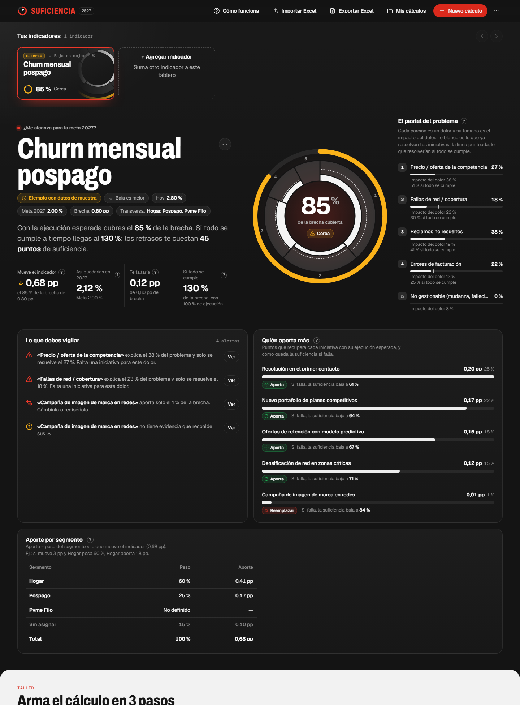
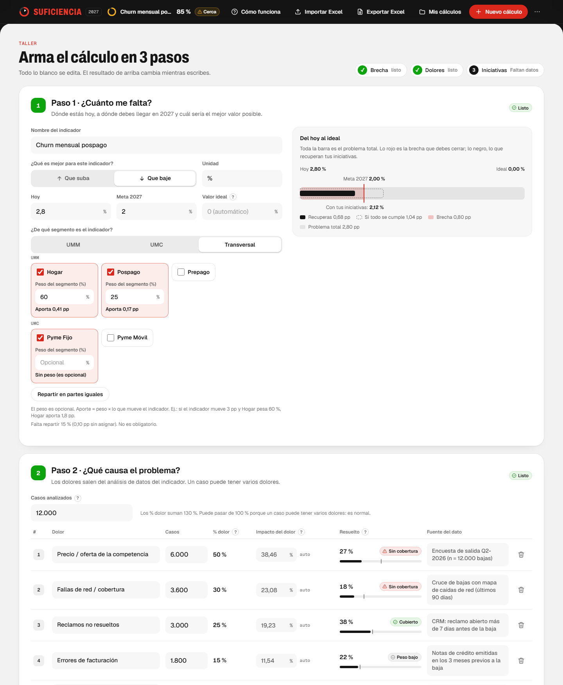
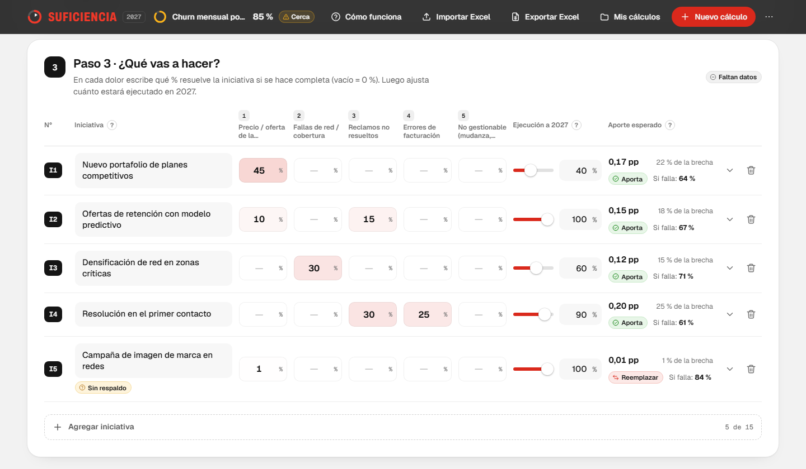
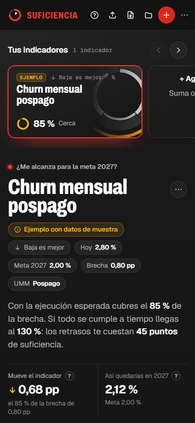

# Calculadora de Suficiencia 2027

Calcula si las iniciativas de cada indicador alcanzan para cumplir la meta 2027 y qué pasa si alguna se retrasa o falla.

- **`suficiencia_cx.html`**: el tablero web. Ábrelo con doble clic o publícalo con GitHub Pages. No necesita instalar nada.
- **`Plantilla_Suficiencia.xlsx`**: la plantilla de Excel. Usa las mismas fórmulas que el tablero, y el tablero puede importarla.

## Así se ve

Capturas del tablero con el ejemplo lleno («Churn mensual pospago», datos de muestra). Lo oscuro es el resultado y solo se lee; lo blanco es el taller, donde se escribe.

**El resultado:** el pastel del problema, el anillo de suficiencia, cuántos puntos mueve el indicador, lo que debes vigilar, quién aporta más y el resultado por segmento.



**El taller, pasos 1 y 2:** hoy, meta y segmento y los dolores con sus casos (con varios segmentos, un bloque por segmento).



**El taller, paso 3:** qué % de cada dolor resuelve cada iniciativa y cuánto estará ejecutado en 2027.



**En el celular** también funciona (aquí a 390 px de ancho):



Además: **Mis cálculos** (guardar, abrir, renombrar y duplicar), **Exportar Excel** (una hoja por indicador con el cálculo paso a paso) y **Descargar respaldo**, como se explica más abajo.

## Descargar el proyecto en otro computador

- **Sin instalar nada:** en GitHub, botón verde **Code › Download ZIP**. Descomprime el archivo y abre `suficiencia_cx.html`.
- **Con Git:** `git clone https://github.com/BrianBarreto93/Calculadora-de-Suficiencias.git`

Qué necesita cada parte:

| Parte | Requisito |
|---|---|
| Tablero (`suficiencia_cx.html`) | Un navegador moderno: Edge, Chrome, Firefox o Safari |
| Exportar e importar Excel (.xlsx) | Nada más: funciona sin internet |
| Importar un Excel antiguo (.xls) | Internet, porque ese lector se descarga de cdnjs. Mejor guárdalo como .xlsx |
| Fuentes del tablero | Internet (Google Fonts). Sin internet se usan las fuentes del sistema |
| Plantilla de Excel | Microsoft Excel 2016 o posterior |
| Herramientas `.ps1` | Windows con Excel (y Edge o Chrome para `probar_tablero.ps1`) |
| Pruebas del motor y del Excel | Node.js 18 o posterior (opcional) |

## Cómo se usa

Al abrir la página se piden **usuario y contraseña** (pídelos a quien administra el tablero). La sesión dura mientras la pestaña esté abierta. Es una puerta de cortesía en el navegador: la página es estática y no protege los archivos del servidor.

1. Mira el **ejemplo lleno** (Churn mensual pospago) para ver cómo se llena un cálculo.
2. Pulsa **+ Agregar indicador** (en **Tus indicadores**) para sumar otro indicador al mismo tablero. Para borrar uno, usa la papelera de su tarjeta.
3. En el **taller** (la parte blanca), llena los 3 pasos:
   1. Hoy, meta 2027, si es mejor que el indicador suba o baje, y el **segmento** (obligatorio): UMM (Hogar, Pospago, Prepago), UMC (Pyme Fijo, Pyme Móvil) o Transversal (de las dos). Con 2 o más segmentos puedes escribir, si quieres, la **parte del problema (%)** de cada uno; si no, sale de sus casos analizados.
   2. Los dolores y sus casos (hasta 15 por segmento). Con varios segmentos hay un bloque por segmento, cada uno con sus casos analizados y sus dolores; **Copiar los dolores de…** trae los nombres de otro segmento para no escribirlos dos veces.
   3. Las iniciativas (hasta 15 por segmento marcado): qué % de cada dolor resuelven, cuánto estará ejecutado en 2027 y, con varios segmentos, **a qué segmentos aplica** cada una (en los demás la celda dice «No aplica»).
4. Lee el resultado arriba (la parte oscura): el pastel, el anillo de suficiencia, cuántos puntos **mueve el indicador**, lo que debes vigilar y quién aporta más. Cada número tiene un **?** que explica qué significa, con un ejemplo.

**Nuevo cálculo** (botón rojo) abre un tablero nuevo. Antes pregunta si guardas el actual (Guardar / No guardar / Cancelar). Lo guardado queda en **Mis cálculos**, donde puedes abrir, renombrar, duplicar o eliminar cada cálculo, y ver su semáforo (cuántos indicadores alcanzan, están cerca o no alcanzan) sin abrirlo.

Todo se guarda solo, a cada cambio, en tu navegador: al volver a abrir la página ves lo que dejaste. Ese guardado es por navegador y por dirección (no se comparte entre equipos ni entre el archivo descargado y la página publicada). Para llevarlo a otro lado: **Mis cálculos › Descargar respaldo** y allá **Cargar respaldo**. Si tienes cálculos guardados y hace más de 7 días (o nunca) que no descargas un respaldo, la página te lo recuerda al abrirla.

Para compartir:

- **Exportar Excel**: descarga un Excel claro con un resumen, una hoja por indicador (resultado, cálculo paso a paso, segmento y datos), los ajustes y un glosario. Se puede editar (celdas azules) y volver a abrir con **Importar Excel**.
- **Importar Excel**: lee un Excel exportado por la calculadora o la plantilla `Plantilla_Suficiencia.xlsx`. Los indicadores con el mismo nombre se actualizan y los demás se agregan.
- **Descargar respaldo (.json)**: copia exacta de todo (Mis cálculos y el tablero actual) para cargarla en otro navegador.

## Cómo se calcula

- **Problema total (el pastel)** = distancia entre hoy y el valor ideal.
- **Brecha** = distancia entre hoy y la meta 2027.
- **% dolor** = casos con el dolor ÷ casos analizados. La suma puede pasar de 100 %.
- **Impacto del dolor** = su % dolor ÷ la suma de los % dolor. Es el tamaño de su porción del pastel y siempre suma 100 %.
- En cada dolor, cada iniciativa deja `1 − efectividad × ejecución`. Lo que queda del dolor es el producto de esos valores: la segunda iniciativa solo resuelve lo que dejó la primera.
- **Puntos recuperados** = problema × impacto del dolor × lo resuelto, sumado en todos los dolores. Son los puntos que **mueve el indicador**.
- **Suficiencia** = puntos recuperados ÷ brecha.
- **Con varios segmentos** (desde el 3 de nov de 2026):
  - **Parte del problema de un segmento** = sus casos analizados ÷ casos de todos los segmentos, o el % que escribas en el paso 1 (los que dejes vacíos se reparten lo que falta según sus casos). Ej.: 7.000 bajas en Hogar y 3.000 en Pospago → 70 % y 30 %.
  - **% dolor** = casos del dolor ÷ casos analizados de **su** segmento. **Impacto del dolor** = parte del segmento × su % dolor ÷ la suma de los % dolor del segmento.
  - Una iniciativa solo resuelve dolores de los segmentos a los que aplica.
  - **Lo que mueve un segmento** = lo que recuperan sus dolores. La suma de los segmentos es lo que mueve el indicador, y su «de la brecha» suma la suficiencia total. Un segmento sin dolores deja su parte del problema sin resolver (la página lo avisa).
  - Con un solo segmento todo es igual que antes. Los cálculos guardados antes de este cambio dan el mismo resultado: si tenían varios segmentos, sus dolores quedan «sin segmento» hasta que elijas el de cada uno, y los pesos viejos (que solo repartían los puntos al final) no se usan.
- El **estado** de una iniciativa (En plan / En riesgo / Retrasada) ya no cuenta: los retrasos se expresan con el % de ejecución. Por eso, donde la plantilla de Excel dice «En riesgo», el tablero dice «Aporta».
- **Aporte de una iniciativa** (desde el 9 de nov de 2026) = su parte de lo que mueve el indicador, en pp. Lo que se recupera en cada dolor se reparte entre las iniciativas que lo atacan según lo que resuelve cada una (efectividad × ejecución). Por eso los aportes **suman exactamente** lo que mueve el indicador. Antes era «lo que se pierde si la iniciativa falla», que no sumaba el total; el tablero ya no muestra «% de la brecha» ni «si falla» por iniciativa. La plantilla de Excel sigue con el cálculo anterior.

## Estructura

```
suficiencia_cx.html           Tablero web
Plantilla_Suficiencia.xlsx    Plantilla de Excel (6 dolores y 8 iniciativas por hoja)
assets/js/acceso.js           Pide usuario y contraseña antes de mostrar el tablero (solo guarda la huella SHA-256)
assets/js/engine.js           Motor de cálculo (las mismas fórmulas del Excel)
assets/js/ejemplos.js         Indicadores de ejemplo (los mismos de la plantilla)
assets/js/excel.js            Escribe y lee archivos .xlsx sin internet
assets/js/app.js              Interfaz del tablero, animaciones y contenido del Excel exportado
assets/css/app.css            Estilos
tests/paridad_excel.test.js   Prueba: motor web = Excel
tests/excel.test.js           Prueba: el .xlsx se escribe bien y se vuelve a leer igual
tests/segmentos.test.js       Prueba: dolores e iniciativas por segmento, parte del problema, guardado y respaldo .json
tests/navegador/              Pruebas del tablero en el navegador (también persistencia y celular a 390 px)
herramientas/                 Scripts para generar y verificar el Excel y probar el tablero
docs/img/                     Capturas del tablero que se ven en este README
docs/prompts.md               Pedidos y prompt final del proyecto
docs/diseno.md                Decisiones de diseño y arquitectura
```

## Verificar

```
node --test tests/paridad_excel.test.js tests/excel.test.js tests/segmentos.test.js
powershell -ExecutionPolicy Bypass -File herramientas\probar_tablero.ps1
powershell -ExecutionPolicy Bypass -File herramientas\verificar_plantilla.ps1
```

`probar_tablero.ps1` también abre con Excel (si está instalado) un archivo exportado por el tablero para confirmar que Excel lo acepta sin repararlo.

Para volver a crear la plantilla desde cero (por ejemplo, después de cambiar una fórmula):

```
powershell -ExecutionPolicy Bypass -File herramientas\generar_plantilla.ps1 -Salida Plantilla_nueva.xlsx
```

## Publicar con GitHub Pages

En el repositorio: **Settings › Pages › Deploy from a branch › `main` / root**. El tablero queda en `https://brianbarreto93.github.io/Calculadora-de-Suficiencias/suficiencia_cx.html`.
